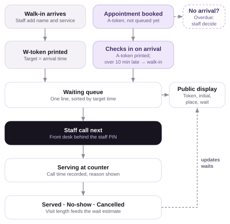
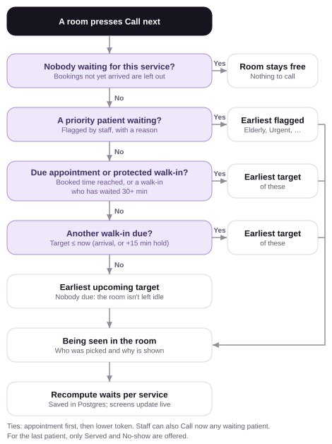

# Token-based clinic queue

A queue for walk-ins and appointments at a small clinic (the demo "Hygieia Wellness Clinic"). One front desk issues
tokens; every patient joins the **queue of their service** (consultation, follow-up, blood test, …), each served by its
own room(s). Staff add patients, call the next one per room and see estimated waits; patients follow their place on a
public display.

- **Live app:** https://queue-management-system-jet-six.vercel.app
  - Staff console: [`/staff`](https://queue-management-system-jet-six.vercel.app/staff) (demo staff PIN `12345`) ·
    settings: [`/staff/settings`](https://queue-management-system-jet-six.vercel.app/staff/settings)
  - Waiting-room display: [`/display`](https://queue-management-system-jet-six.vercel.app/display),
    with `?token=CW-004` to highlight one patient

> **Before you start:** sign in to the staff console with PIN `12345`, then open **Settings** (left sidebar):
> - **Load sample day** fills the five queues with fictional patients (some served, two being seen, some waiting,
>   a priority patient, and appointments, including an overdue one), so you can try everything straight away.
> - **Reset day** clears today's queue and restarts every token sequence (CW-001, CA-001, BW-001 …), for testing
>   from scratch. Settings and services are kept.
>
> The queue also clears itself at midnight (Dhaka time), so if the lists look empty, use one of these.

- **Host:** Vercel (Next.js, functions in Singapore `sin1`); data in **Postgres on Supabase** (Singapore,
  `ap-southeast-1`; functions and database must share a region: each database round trip crosses it), with
  **Supabase Realtime** pushing every change to open screens.

## How to run

Requires Node.js 22+ (built on 24 LTS).

```bash
cd queue-app
npm install
npm run dev          # http://localhost:3000 (redirects to /staff)
npm test             # Vitest: queue logic, seed data, staff PIN, and the Postgres store (on PGlite)
npm run test:e2e     # Playwright: staff flows + display sync (uses installed Edge; PW_CHANNEL=chrome to switch)
npm run build        # production build
```

**Data.** Without a database URL the app keeps the queue in the server's memory, which is fine for a quick look.
For a real local Postgres without Docker:

```bash
npm run db:local     # PGlite as a Postgres server on port 5433, data in .pglite/
DATABASE_URL=postgres://postgres@localhost:5433/postgres npm run db:migrate
DATABASE_URL=postgres://postgres@localhost:5433/postgres npm run dev
```

On Vercel, Supabase's integration sets `POSTGRES_URL` / `POSTGRES_URL_NON_POOLING` (server) and
`NEXT_PUBLIC_SUPABASE_URL` / `NEXT_PUBLIC_SUPABASE_PUBLISHABLE_KEY` (browser, for Realtime only). Every deploy runs
`db/migrate.mjs` and `db/check.mjs` before building: migrations are applied, and the build fails if any table is left
without row-level security. An empty database starts with the fictional sample day.

E2E against the live site: `E2E_BASE_URL=https://queue-management-system-jet-six.vercel.app E2E_STAFF_PIN=<pin> npm run test:e2e`
(it resets the day's data).

## Layout

```
docs/                     requirements, workflow diagrams, documentation (Word)
CLAUDE.md                 the final queue rules (source of truth for lib/queue.ts)
queue-app/
  lib/queue.ts            all queue logic: pure functions, `now` always passed in
  lib/time.ts             Asia/Dhaka day key, 5-minute slots
  lib/seed.ts             fictional sample day
  lib/store.ts            Postgres or memory; read → apply → compare-and-set on version, with retries
  lib/pg-store.ts         QueueState ↔ rows, one transaction per write
  db/migrations/          the schema, row-level security and Realtime setup (SQL)
  db/migrate.mjs, check   apply migrations; print and enforce the security setup
  components/live-updates Supabase Realtime subscription (the clinic row only)
  app/api/state           GET staff view, or ?view=public (token + initial only)
  app/api/action          POST one staff action, applied atomically
  app/staff, app/display  the two screens
  tests/, e2e/            Vitest and Playwright
```

## Staff PIN

The front desk (`/staff`, its settings and the staff API) is behind one shared staff PIN; the waiting-room
display stays public.

> **Demo PIN: `12345`.** This is a simulation with fictional patients, so the PIN for the live demo is
> published here on purpose so reviewers can sign in. A real clinic would keep its PIN out of the repository.

- Set it on Vercel, then redeploy: `vercel env add STAFF_PIN production` (4–8 digits), then `vercel --prod`.
  To change it, `vercel env rm STAFF_PIN production`, add it again, and redeploy; everyone is signed out.
- A correct PIN gives that browser a signed, httpOnly cookie for 12 hours (one shift). **Lock** signs it out.
- 5 wrong PINs from one address lock sign-in for 5 minutes (counted in the database).
- Without `STAFF_PIN` (local development) the front desk is open.
- Optional `AUTH_SECRET`: any long random string, mixed into the cookie signature.
- Testing with a PIN: run a server with `STAFF_PIN=<test pin>`, then
  `E2E_BASE_URL=<that url> E2E_STAFF_PIN=<test pin> npm run test:e2e`.

## Services and rooms

| Service | Letter | Default length | Rooms |
|---|---|---|---|
| General consultation | C | 15 min | 1 |
| Follow-up | F | 10 min | 1 |
| Blood test | B | 5 min | 1 |
| Vaccination | V | 5 min | 1 |
| Prescription renewal | P | 5 min | 1 |

- Each service has its **own queue**; its rooms call only from it. Rooms per service: 1–4 (Settings).
- **Add a service** in Settings → *Services and departments*: a name, a **unique token letter** (suggested from the
  name), a default length and rooms. Dental with letter D issues DW-001 / DA-001 and appears at once on the front desk,
  the timeline and the display, with its own colour. Up to 10 services.
- **Remove a service** once nobody is booked, waiting or being seen for it today (never the last one). Its finished
  patients stay in today's history.

## Tokens

| | |
|---|---|
| **Format** | Service letter + **W** (walk-in) or **A** (appointment) + 3 digits: `CW-004` is the 4th consultation walk-in, `BA-002` the 2nd blood-test appointment. Each prefix counts on its own and restarts each day (Dhaka time) or on **Reset day**. |
| **When it's issued** | A walk-in gets its token as soon as staff click **Add walk-in**. An appointment gets its token when it's booked (quote it to the patient); it joins the queue only when they **Check in**. |
| **It never changes** | Editing a patient keeps the token. A patient more than 10 minutes late keeps their A-token but joins as a walk-in ("Late, now walk-in"). Changing service means cancelling and adding them again (another queue, another token). |
| **Printing** | After **Add walk-in** or **Check in**, a strip shows the token, place and wait with **Print token**. Every Waiting row has **Print** for a reprint. |
| **The slip** | Logo, the token in large type, walk-in or appointment time, service, room, place in that queue, estimated wait, time issued, and a **QR code** that opens the patient's place on the display (`/display?token=…`). **No patient name.** 80 mm page (80 × 160 mm) for receipt printers; any printer works through the browser's print dialog. |
| **Being called** | The room's pill on the front desk shows the token; click it for the reason it was picked. The display shows it in that service's panel under *Now serving*, with the room. |
| **Following your token** | The display lists every waiting token per service with its first initial, place and wait. `/display?token=CW-004`, or **Find my token**, highlights it: "You are number 2 in the General consultation queue" or "It's your turn. Please go to General consultation · Room 1." |

## The front desk

- **Title row:** today's summary (waiting, longest wait, priority, overdue) and, on its right, **Next hour**: one thin lane per
  room in its service colour (solid = being seen, pale = projected). Hover a lane to see its room's name.
- **Add patient** (walk-in or appointment) with **Check in** (booked appointments not here yet) under it; on the right,
  **Rooms**: one pill per room with its always-visible action (**Call next**, **Served & call next**, or **Served** for the
  last patient). Click a pill for the patient, times, the reason they were called and **No-show**.
- **Waiting** (full width, filterable by service): place, target, wait, **Call now** (when that service has a free room),
  **Priority** (Elderly, Pregnant, Disability, Urgent, Other), **Print**, **Edit**, **Cancel**. **Finished today** folds away below.

## Workflow





Diagrams are generated by `queue-app/scripts/diagrams.mjs`. The design documentation is the Word file
[`docs/documentation.docx`](docs/documentation.docx): decisions, assumptions, queue logic and wait times,
plus appendices on the Claude Code skills used and how to test. Rebuild it with `node scripts/docs-docx.mjs`.

## How to test the platform

Open the front desk at https://queue-management-system-jet-six.vercel.app/staff and sign in with the demo PIN `12345`.
Open https://queue-management-system-jet-six.vercel.app/display in a second window, side by side. In **Settings**, click
**Reset day** to start from an empty queue (or **Load sample day** for a busy morning). All names are fictional.

| # | Do this | You should see |
|---|---|---|
| 1 | Add a walk-in: name "Rina", General consultation, **Add walk-in**. | Token **CW-001**, place 1, *Due now*. The display's General consultation panel shows **CW-001 R.** within about a second (the display header says *Live*). |
| 2 | Click **Print token**, then scan the slip's QR code with a phone. | An 80 mm slip with CW-001, the service, Room 1, place, wait and a QR code, and no name. The QR opens the display with CW-001 highlighted. |
| 3 | Add a walk-in "Karim", **Blood test**. | **BW-001**, place 1 in the Blood test queue, *Due now*: a separate queue with its own room. |
| 4 | Choose **Appointment**, "Sadia", General consultation, a time 30+ min ahead, **Book appointment**. Then book "Omar", **Blood test**, the **same time**. | CA-001 and BA-001 both booked: services share times. A second consultation at that time is refused ("full for General consultation"). |
| 5 | In **Check in**, click **Check in** for CA-001. | CA-001 joins *Waiting* with an "Appt" label, behind CW-001 (its time is later). |
| 6 | On the General consultation pill click **Call next**. | CW-001 is called; click the pill to read the reason. The display shows it under *Now serving*. |
| 7 | Click **Served & call next**. | CA-001 "called early: nobody is due yet". Only **Served** remains while nobody else waits. |
| 8 | Add walk-ins "Lina" and "Rafi" (consultation), set **Priority → Elderly** on Rafi, then serve CA-001 and **Call next**. | Rafi is called first: "priority (Elderly)". |
| 9 | Book a consultation 10 min ahead and check it in, then add a consultation walk-in. | The walk-in shows "target … · after CA-00x": held 15 min so the appointment goes first. |
| 10 | Settings → *Services and departments*: add "Dental" (letter D). | Dental appears in Add patient, Rooms, the timeline and the display; a walk-in gets DW-001. |
| 11 | Click **Lock** in the sidebar. | The PIN screen appears; the display window keeps working. |

Automated: `npm test` (58 unit and database tests) and `npm run test:e2e` (7 browser tests) from `queue-app/`. See [Tests](#tests).

## Ordering rule (per service queue)

Every checked-in patient has a **target time**:

| Patient | Target time |
|---|---|
| Walk-in | arrival time, **or arrival + 15 min** if an appointment of the same service (booked or checked in) is due within the next 15 min |
| Appointment, checked in on time or early (up to scheduled time + 10 min grace) | scheduled time |
| Appointment, checked in after the grace period | as a walk-in (above): re-queued, keeps its A-token, flagged "Late, now walk-in" |

**Call next** (per room, run on the server, within that room's service):

1. **Priority** patients first (flagged by staff), earliest flagged first.
2. **Due appointments** (scheduled ≤ now) and **protected walk-ins** (waited ≥ 30 min, adjustable; 0 = off), by target time.
3. **Other due walk-ins** (target ≤ now), by target.
4. Nobody due → the **earliest upcoming** target, so the room is not left idle.
5. Ties → appointment before walk-in, then the lower token number.

Staff can also **Call now** any waiting patient of that service into a free room. Every call shows who and why, e.g.
*"CA-003 called: appointment at 10:30 is due, and appointments go ahead of walk-ins at their time."*

**Does an appointment always beat a walk-in?** Almost: at its time it goes ahead of anyone who is not priority or
protected, and the 15-minute hold means a walk-in arriving shortly before it no longer takes the room first. It can still
wait behind a **priority** patient, a walk-in who has already waited 30+ minutes, a staff **Call now**, or a patient
already in the room.

## Wait-time formula

- **Expected length per service** = mean of the last 5 real visits (called → served) for that
  service, each clamped to 1 min … 3 × the default. No visits yet → the default. No-shows never count.
- **Each room is free at** `now` if idle, otherwise `now + max(expected − elapsed, 1 min)`.
- **Forward simulation per service:** repeatedly take the room that frees up first, at time `t`, and apply the
  *same* call-next rule at `t`. That patient starts at `t`; the room is next free at `t + expected`.
  `wait = start − now`, and **position** is the order within that service's queue.
- **Shown as** "Due now" when ≤ 2 min, otherwise "~X min" rounded **up** to the next 5.
- Recomputed on every change (pushed through Realtime) and on a timer (every 15 s while live, 3 s without
  Realtime), so waits keep counting down. The "Next hour" timeline draws the same projection.

## Assumptions

- One clinic, one front desk, timezone Asia/Dhaka. Tokens restart each clinic-local day; *Reset day* does it by hand.
- Five services by default, each with 1 room (1–4 configurable); services can be added or removed in Settings.
- Grace period 10 min (0–60); walk-in protection 30 min (0–240, 0 = off).
- Appointments are booked for today only, in 5-minute slots, at or after the current time. Someone already present is a walk-in.
- **No double-booking within a service:** an appointment occupies scheduled time → + the service's default length. A booking is refused
  when that service's overlapping appointments would exceed its rooms. Other services can share the time. Reducing rooms never cancels
  bookings; Settings lists the overlaps.
- No automatic no-shows. An appointment past its grace period is flagged *Overdue*; staff check it in (it becomes a walk-in), mark no-show or cancel.
- A called patient who doesn't come is marked no-show. If they return, they are added again as a new walk-in.
- Name and (for appointments) time can be edited while booked or waiting, never after being called.
- Only a name and a service are collected. The public display shows the token and first initial only; priority reasons are never shown.
- No customer login, payments, SMS or notifications.

## Trade-offs

- **Separate queues per service** keep a quick blood test from waiting behind long consultations, at the cost of one more choice
  at the desk (the service decides the queue and the token).
- **Appointments are honoured at their time; walk-ins may wait about one extra visit.** The 15-minute hold makes this explicit for
  walk-ins who arrive just before a booking.
- **Walk-in protection** stops a walk-in being pushed back again and again on a busy booked day.
- **Priority is a staff judgement,** shown with its reason on the staff screen only.
- **Idle-fill can delay an appointment slightly:** calling an early patient into a free room may mean it is busy when a slot comes
  due. Keeping rooms working was judged worth it; the estimate accounts for it.
- **The overlap check is conservative:** with 2+ rooms it can refuse a slot where the real peak would just fit.
- **Estimates, not promises.** They improve as real visit times accumulate.
- **Push a nudge, not the data.** Realtime only tells screens *that* the queue changed (the clinic row's version);
  they refetch through their own API. Patient data never goes over the public channel, at the cost of one extra
  request per change. If Realtime drops, screens fall back to polling every 3 s.
- **The rules stay in TypeScript, the database enforces the invariants.** `lib/queue.ts` decides; Postgres guarantees
  one token per day, one active service per letter, and one patient per room, and every write is a version-checked
  transaction. Round trips are kept low: a read is one SQL statement returning the whole state, and a write touches
  only the rows that changed (adding a walk-in is 5 statements in all). Both API routes send a `Server-Timing`
  header (`db`, `view`) so the cost can be checked in the browser's dev tools.

## Limitations

- Staff sign-in is one shared PIN, not individual accounts: there is no record of *who* pressed a button.
- One clinic per deployment (no multi-branch support). A service can't be renamed or re-lettered once added (remove and add it).
- Without a database (quick local runs) the queue lives in one server process's memory and is lost on restart.
- History is stored (every day's visits and calls) but there are no reports on it yet.
- Times are server times; there is no offline mode.

## Tests

- **Postgres store** (`tests/pg-store.test.ts`, 6 tests on PGlite, a real Postgres in-process, with the same migrations and
  client as production): the sample day round-trips exactly; a stale write is refused; serve & call next, priority, holds and the
  call history are stored; a removed service is archived with its history kept; Reset day clears the day; the database itself
  refuses two patients in one room; the PIN counter.
- **Vitest** (`queue-app/tests`, 52 more tests): tokens per service; separate queues and rooms; FIFO; an appointment due before an earlier
  walk-in; early appointments waiting; walk-in protection; late conversion and the grace boundary; ties; two rooms; priority and
  Call now; the 15-minute walk-in hold (including the cases where it doesn't apply); booking clashes within a service only, edits and
  overdue; adding and removing services; the clamped last-5 average and overrun floor; the documentation's worked example; daily reset;
  public-view privacy; seed data; the staff PIN.
- **Playwright** (`queue-app/e2e`, 7 tests + 2 with a PIN): the full staff flow; separate queues, priority and Call now; printing;
  double-booking within a service; appointments of different services at the same time, in any order; adding and removing a service;
  `/display` following each change. Runs locally and against the live URL.
